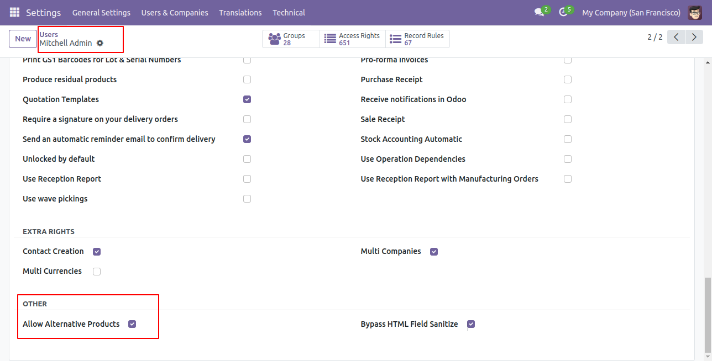
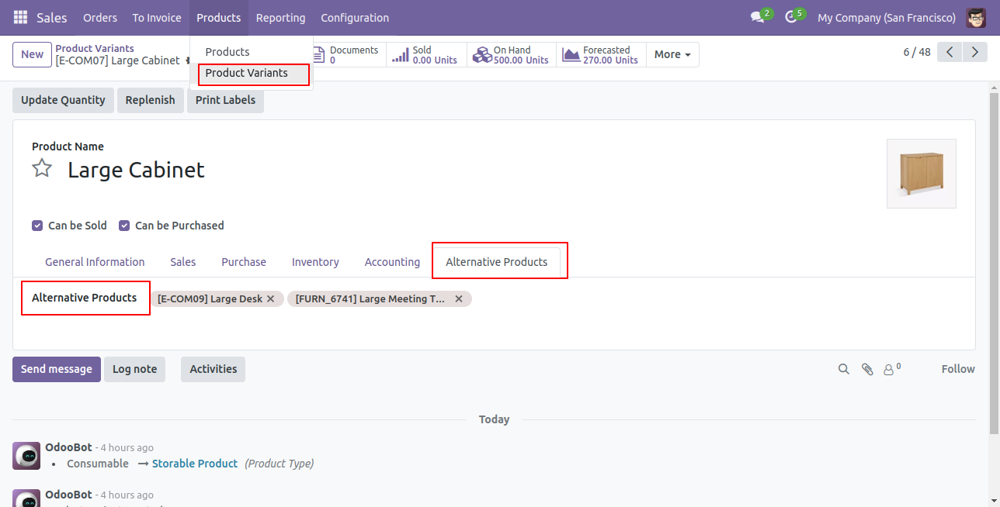
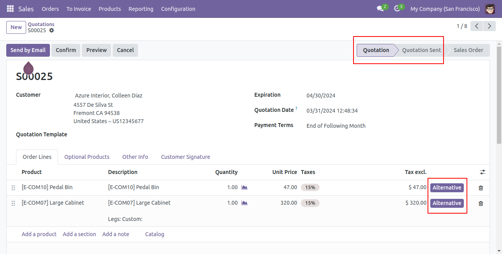
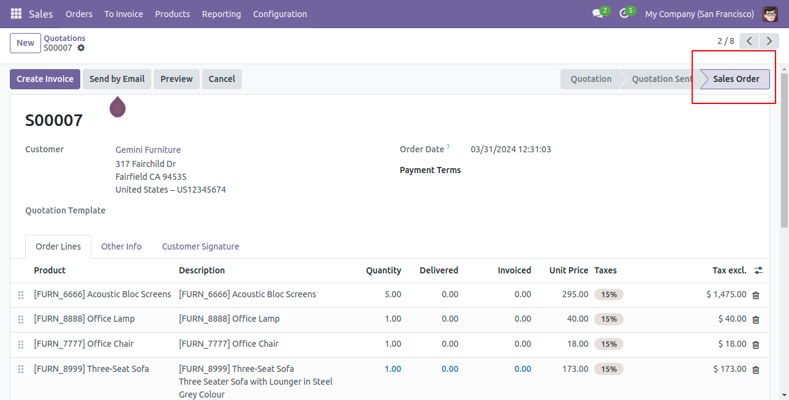
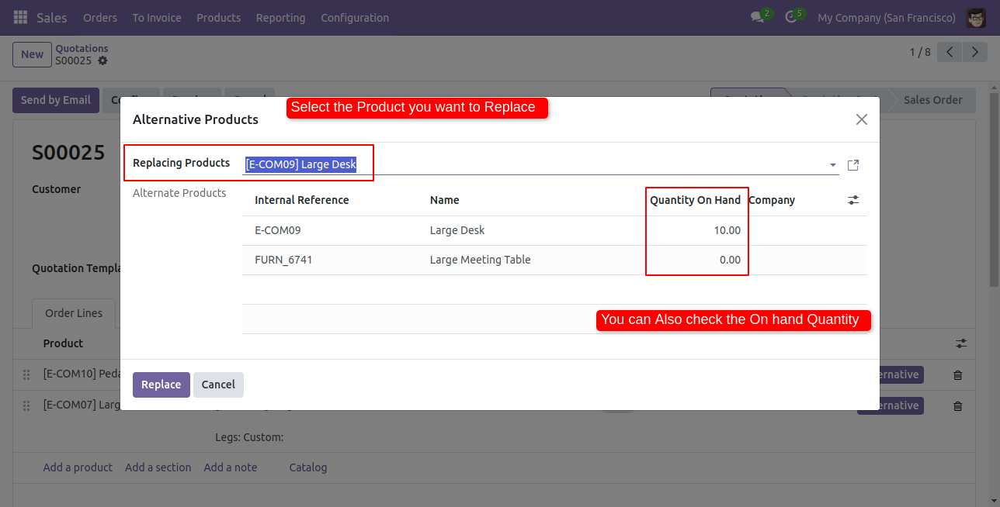
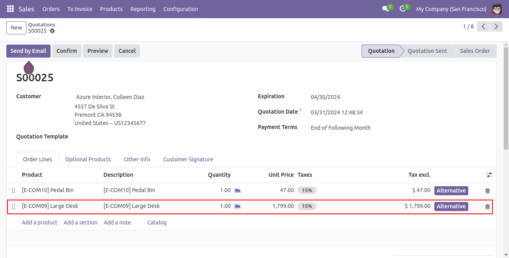

# Alternative Products on Quotations

   

When an item is out of stock or over budget, sales staff need to offer a substitute without rebuilding the quotation. This app lets you list alternative products on a variant and swap one into a quotation line in two clicks, with the price taken from the quotation's pricelist.

## What it does

- Define alternative products on each product variant
- Alternative button on quotation lines in the Quotation and Quotation Sent stages
- Wizard to pick the substitute, with the line price recomputed from the pricelist
- Button hidden once the order is confirmed, so confirmed orders are not changed by accident
- Access controlled by a user group

## How to use it

1. Add the users who may swap products to the Alternative Products group.
2. On a product variant, list its alternatives.
3. On a quotation line, click Alternative and choose the replacement.

## Screenshots

## Technical notes

Technical name `alternative_sale`, Odoo 17.0.

Extends `sale.order`, `sale.order.line` and the alternative wizard of `pt_alternative_base` (Alternative Product Base by Praj Technologies). Depends on `sale_management` and `stock`.

> Requires `pt_alternative_base` by Praj Technologies. The Odoo App Store adds it to the purchase automatically.

## Get the module

Buy it on the [Odoo App Store](https://apps.odoo.com/apps/modules/17.0/alternative_sale) for EUR 14, including the required base module. The purchase includes the full source code under the OPL-1 licence.

Need it on another Odoo version, with changes for your workflow, or installed and tested on Odoo.sh? Email [iusmanghias@gmail.com](mailto:iusmanghias@gmail.com?subject=alternative_sale%20customisation) or see [CODCrafters](https://codcrafters.org).

---

This repository is the product page. The module source is private and comes with the licence.

Built by [Usman Ghias](https://usmanghias.co.uk), [CODCrafters](https://codcrafters.org).
